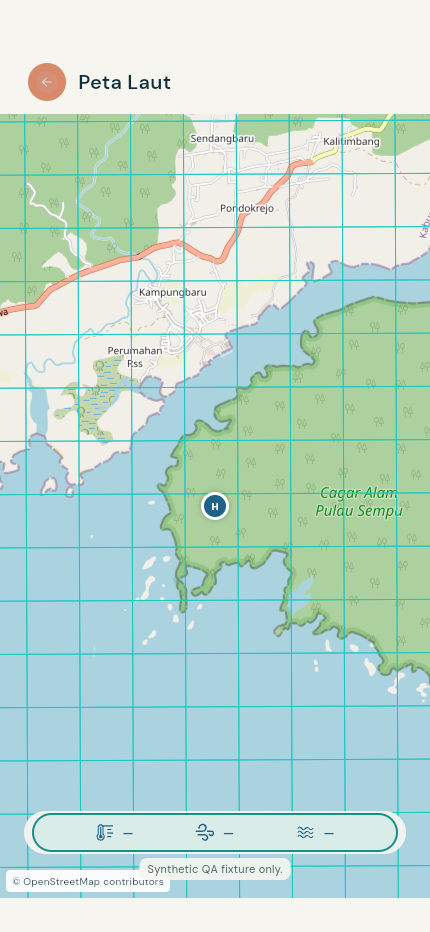
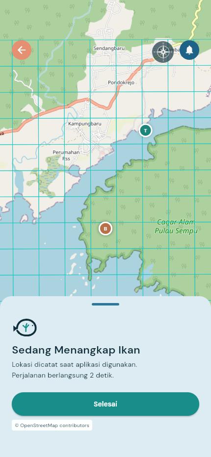

# Reefish — Tangkap & Pulih

**Membantu nelayan merencanakan dan mencatat perjalanan, sekaligus memberi pihak konservasi alat untuk mengelola tekanan penangkapan per petak laut.** Reefish adalah prototipe JOINTS Hackathon 2026: aplikasi Flutter untuk nelayan dan dashboard Next.js untuk peran `konservatif`, dengan backend serta aturan kawasan bersama.

Nelayan membutuhkan informasi lokasi, cuaca dan perkiraan BBM; pengelola membutuhkan catatan aktivitas serta kendali kawasan yang dapat ditelusuri. Reefish menghubungkannya melalui grid 500 × 500 m: catatan perjalanan menjadi masukan pengelolaan, keputusan zona kembali menjadi batas pemilihan lokasi nelayan. Penghematan BBM dan pemulihan terumbu merupakan **hipotesis dampak yang perlu diuji di lapangan**, belum hasil terukur proyek ini.

**Mulai di sini:** [mobile](frontend/mobile/README.md) · [web konservasi](frontend/web/README.md) · [backend](backend/README.md) · [kontrak](contracts/README.md) · [data dan ML](machine-learning/README.md).

<p>
  
  
</p>

Tampilan dari [preview QA terkontrol](frontend/mobile/qa/remaining/README.md): widget aplikasi dengan data/GPS sintetis, bukan bukti perjalanan produksi.

## Cara kerja dan arsitektur

1. Nelayan masuk melalui Supabase Auth, melengkapi kapal dan mencatat perjalanan beserta titik tangkap.
2. Supabase menyimpan data sesuai kepemilikan akun. `client_trip_id` menjaga retry agar tidak menggandakan trip; SQL menghitung heatmap, tekanan, CPUE dan indikator fatigue.
3. Pengelola memilih grid lalu menetapkan zona `restricted` (kuota) atau `rehab` (tertutup). Saran sistem tetap memerlukan keputusan manusia.
4. Mobile membaca data dan kebijakan. Sel rehab tidak dapat dipilih untuk menangkap; status yang belum terverifikasi tidak dianggap izin. Go menyediakan cuaca dan rekomendasi heuristik dengan filter kelayakan server.

```text
Flutter / nelayan                     Next.js / konservatif
Cubit + SailingBloc + repository      heatmap, seleksi, keputusan zona
                 \                    /
                  Supabase Auth + Postgres/PostGIS
                  RLS + RPC + heatmap + riwayat zona
                         |
                  Go Gin + Open-Meteo
                  ranking heuristik, cuaca, simulasi rute/BBM

Data historis → persiapan data → layer per grid/periode
```

Grid analitis memakai EPSG:32749, ukuran 500 m, origin `(637500, 8988000)`. Koordinat API memakai WGS84; urutan GeoJSON `[lon, lat]`. Backend memakai ID `X{xxx}_Y{yyy}` beserta pemetaan ID kanonis berversi. Rumus dan kompatibilitas lintas klien ada di [kontrak indeks grid](contracts/grid-index.md).

| Direktori | Tanggung jawab |
|---|---|
| [`frontend/mobile/`](frontend/mobile/README.md) | Flutter: auth, peta laut, perjalanan, sesi berlayar dan akun nelayan |
| [`frontend/web/`](frontend/web/README.md) | Next.js: heatmap, flag, keputusan dan riwayat zona |
| [`backend/`](backend/README.md) | Supabase untuk data/otorisasi; Go Gin untuk komputasi |
| [`contracts/`](contracts/README.md) | OpenAPI, kebijakan lock, rumus dan fixture grid |
| [`machine-learning/`](machine-learning/README.md) | Persiapan/audit data, notebook EDA/clustering dan rencana evaluasi |
| [`docs/frontend/hackathon-integration.md`](docs/frontend/hackathon-integration.md) | Bukti integrasi hosted yang direkam dan sisa lingkup |

## Status prototipe dan batas bukti

Ringkasan berdasarkan source dan laporan tersimpan pada **16 Oktober 2026**. Hasil pemeriksaan historis mengikuti konteks laporan masing-masing. Pembaruan dokumentasi ini tidak menjalankan ulang seluruh pengujian atau menjamin layanan demo selalu tersedia.

| Area | Implementasi tersedia | Batas |
|---|---|---|
| Auth dan perjalanan | Phone/password, alur OTP, sesi/logout, kapal, trip, riwayat/detail, draft pending dan retry idempoten | OTP bergantung provider SMS. Penyimpanan memakai SharedPreferences; belum outbox SQLite dengan sinkronisasi penuh. |
| Peta laut | Layer/habitat melalui RPC, snapshot bawaan berlabel, detail grid, status rehab dan validasi pemilihan | Import demo hosted mencakup **2025-12**, bukan pengamatan saat ini. Nilai hilang tetap NoData. |
| Mode berlayar | Manual/tercatat, `SailingBloc`, GPS foreground, pause/resume, ringkasan dan persistensi lokal | Interaksi perangkat fisik dan pelacakan background belum dibuktikan; unduhan basemap dan routing offline belum tersedia. |
| Pengelolaan zona | Heatmap, seleksi multi-grid, kuota, rehab, riwayat, flag dan refresh asinkron | Pantau pelanggaran disembunyikan sampai backend tersedia; push belum terhubung end-to-end. |
| Cuaca, rekomendasi dan rute | Open-Meteo melalui Go, ranking `heuristic-0.1`, simulasi rute dan estimasi BBM | Belum inferensi ML live atau prediksi tangkapan tervalidasi. Rute belum alat navigasi operasional. |
| Eksperimen ML | [Notebook EDA/clustering](machine-learning/notebooks/README.md) dengan MiniBatchKMeans pada fitur lingkungan dan pemeringkatan cluster | Output tersimpan belum dijalankan ulang pada pembaruan ini. Input lengkap belum tersedia di Git; notebook memakai path Colab/Drive dan belum terhubung ke inferensi live. |
| Distribusi | Catatan deploy web/Go dan APK release **1.0.1+3** | APK, data dan kunci signing di luar Git. Build/sertifikat belum membuktikan interaksi perangkat fisik. |

Keluaran model historis tidak membuktikan kelimpahan ikan atau kesehatan karang. Satuan beberapa sumber dan kamus kelas karang masih memerlukan konfirmasi; lihat [batas data](machine-learning/data/README.md). Ranking heuristik dipisahkan dari rencana model ML agar demo tidak menyatakan akurasi yang belum dievaluasi.

## Menjalankan dan memeriksa

```powershell
git clone https://github.com/Malwildan/reefish.git
cd reefish
```

**Mobile:** siapkan Flutter (CI memakai 3.47.7). Salin `frontend/mobile/config/supabase.example.json` menjadi `supabase.local.json` di direktori yang sama, lalu isi URL Supabase, publishable key dan URL Go API lingkungan demo. File lokal diabaikan Git.

```powershell
cd frontend/mobile
flutter pub get
./scripts/run.ps1 -Device edge
```

Preview ukuran desain: `./scripts/preview.ps1` (default `http://127.0.0.1:4186`). Preview sintetis tanpa akun live mengikuti [panduan QA](frontend/mobile/qa/remaining/README.md); APK mengikuti [panduan release](frontend/mobile/RELEASE.md) dan memerlukan material signing privat lokal.

**Web:** siapkan Node.js yang kompatibel dengan Next.js 16, isi `.env.local` sesuai [README web](frontend/web/README.md), lalu jalankan dari `frontend/web`:

```powershell
npm ci
npm run dev
```

**Backend/data:** ikuti [setup Supabase](backend/supabase/setup/README.md) dan [Go API](backend/api/README.md). Diperlukan migrasi, data lokal yang tidak dilacak Git, konfigurasi dan akun dengan role sesuai. URL layanan tercatat: [admin demo](https://reefish-admin.vercel.app) dan [health Go](https://reefish-api-production.up.railway.app/health/live).

| Pemeriksaan | Direktori | Perintah / referensi |
|---|---|---|
| Flutter | `frontend/mobile` | `flutter analyze`, `flutter test`, `flutter build web --no-web-resources-cdn` — [workflow](.github/workflows/flutter.yml) |
| Web | `frontend/web` | `npm test`, `npm run lint`, `npm run build` |
| Go | `backend/api` | `go vet ./...`, `go test ./...` |
| Edge Functions dan SQL | root repo / database uji | [Workflow backend](.github/workflows/backend.yml), [smoke test SQL](backend/supabase/tests/README.md) |

Tes web mencakup vektor grid dan parser heatmap. Cek sintaks SQL tidak menggantikan smoke test database. README QA menjelaskan fixture, viewport dan pemeriksaan yang belum tuntas.

## Skenario demo 6 menit

Siapkan akun nelayan/konservatif khusus demo, konfigurasi, internet, periode data yang tersedia dan grid uji sebelum presentasi. Perubahan zona dilakukan pada lingkungan/data demo yang disiapkan tim. Jika memakai preview sintetis, jelaskan bahwa respons dan GPS adalah fixture, bukan penulisan backend live.

| Waktu | Tampilan | Pesan dan bukti |
|---|---|---|
| 00:00–00:45 | Masalah nelayan/pengelola dan dua aplikasi | Siklus tangkap–pulih dan siapa yang memutuskan. |
| 00:45–02:00 | Dashboard nelayan, cuaca/rekomendasi, detail petak | Periode data, NoData dan label heuristik; tanpa janji hasil tangkapan. |
| 02:00–03:00 | Catat perjalanan, buka riwayat/detail | Lokasi rencana berbeda dari tangkapan aktual; UUID tetap saat retry. |
| 03:00–04:15 | Web: heatmap → pilih grid → rehab → riwayat | Kuasa manusia, cakupan grid dan audit keputusan. |
| 04:15–05:00 | Refresh mobile pada grid demo yang sama | Rehab tetap terlihat tetapi pemilihan ikan ditolak; pulihkan keputusan uji sesuai rencana demo. |
| 05:00–06:00 | Kontrak, QA tersimpan, arsitektur dan pilot | Batas GPS/offline/ML dan ukuran keberhasilan yang akan diukur. |

Cadangan presentasi: [tangkapan QA dan manifest desain](frontend/mobile/qa/remaining/README.md), [hasil integrasi yang direkam](backend/supabase/setup/integration-verification.json). Bukti tersebut memiliki lingkup tertentu dan tidak menggantikan demo live yang belum dilakukan.

## Kelayakan pilot dan ukuran keberhasilan

Pilot perlu melibatkan nelayan dan pengelola untuk memvalidasi keterbacaan UI di laut, hak penggunaan data, kuota dan parameter fatigue. Ukur BBM per perjalanan pada kondisi sebanding, kelengkapan logbook, retry tanpa duplikasi, keterlambatan kebijakan sampai mobile dan kepatuhan zona. Baseline, sampel, periode dan target disepakati sebelum pengukuran; belum ada angka capaian lapangan yang dapat dilaporkan.

Prioritas berikutnya: uji perangkat fisik/koneksi buruk, ketahanan penyimpanan/sinkronisasi, kalibrasi BBM/rekomendasi dan kebijakan lintas peran. Evaluasi ekologis memerlukan pendampingan ahli. Evaluasi ML perlu pembanding heuristik, pemisahan data spasial/waktu dan metrik sebelum model menggantikan fallback.

## Berkontribusi

Ikuti [CONTRIBUTING.md](CONTRIBUTING.md), README modul dan kontrak terkait. Perubahan lintas domain dimulai dari kontrak. `main` saat ini memuat beberapa berkas data dan notebook; [README data](machine-learning/data/README.md) membedakan berkas terlacak dari input lokal serta metadata yang belum tersedia. Penambahan dataset perlu meninjau izin/provenance; data pribadi, token, `.env`, kunci signing, bobot dan build tetap di luar Git. Backend menjadi otoritas izin dan validasi.
