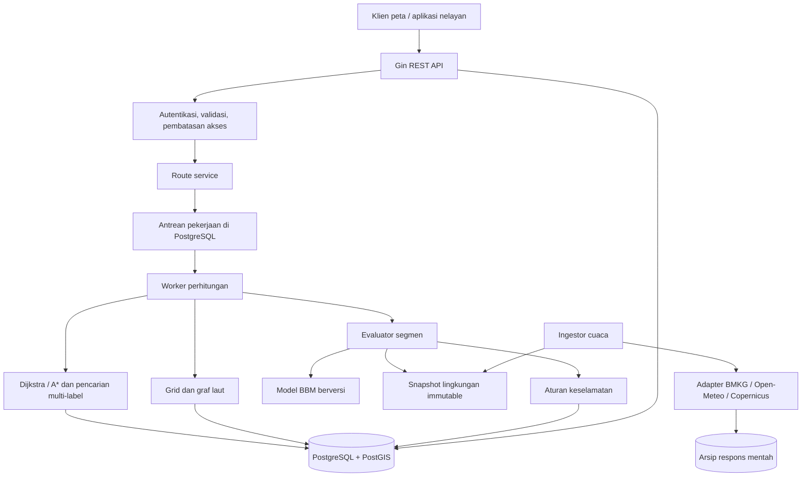

# Spesifikasi Teknis Backend Optimasi Rute Nelayan Berbasis Estimasi BBM

**Bahasa implementasi:** Go (Golang) · **HTTP framework:** Gin  
**Versi dokumen:** 1.0 · **Tanggal:** 16 Oktober 2026  
**Status:** spesifikasi implementasi; belum merupakan sistem yang telah divalidasi di laut.

## 1. Tujuan dan batas klaim

Backend menghitung jalur dari titik keberangkatan menuju satu spot tangkapan dan kembali ke titik pulang. Jalur dipilih berdasarkan **estimasi konsumsi BBM**, setelah memenuhi batas keselamatan, kemampuan kapal, ketersediaan data, waktu, dan cadangan BBM.

Masukan utama meliputi arah/kecepatan angin, arah/kecepatan arus, kecepatan kapal, kurva konsumsi BBM, koordinat tujuan, waktu berangkat, durasi di spot, serta kondisi muatan pergi dan pulang. Laut direpresentasikan sebagai grid nominal 500 meter.

Keluaran berisi jalur pergi dan pulang, estimasi waktu/BBM, asumsi, asal dan umur data, alasan penolakan, serta tingkat kelayakan penggunaan hasil. **Rute dengan estimasi BBM lebih rendah belum membuktikan penghematan BBM riil.** Bukti penghematan memerlukan pencatatan konsumsi aktual dan pembandingan yang layak.

Prinsip wajib:

1. Arah angin pada kontrak internal memakai **from**; arah arus memakai **to**. Adapter harus membaca konvensi setiap variabel sumber.
2. Kecepatan jelajah kapal dinyatakan sebagai **STW**, bukan SOG dari GPS.
3. Arus memengaruhi vektor kecepatan terhadap bumi; pengaruh angin/gelombang terhadap BBM memerlukan model kapal yang dikalibrasi.
4. Keselamatan adalah batas wajib. Penalti biaya tidak boleh membuat lintasan terlarang menjadi layak.
5. Rute pulang dihitung tersendiri; membalik koordinat rute pergi tidak cukup.
6. Grid 500 m adalah resolusi pencarian, bukan jaminan resolusi maupun akurasi prakiraan.
7. Hasil sistem adalah alat bantu perencanaan. Rute tidak menjamin keselamatan atau keberhasilan tangkapan.

### 1.1 Cakupan awal

- Satu kapal, satu spot, satu keberangkatan dan satu kepulangan.
- Lokasi asal dan pulang boleh berbeda.
- Kecepatan STW tetap per fase perjalanan pada MVP; pilihan beberapa STW dikembangkan setelah kurva BBM tersedia.
- Muatan pergi dan pulang ditetapkan eksplisit. Perubahan muatan selama pelayaran belum dimodelkan.
- Aktivitas di spot mempunyai durasi, model BBM, dan kebijakan mempertahankan posisi.
- Data kedalaman, daratan, zona larangan, peringatan, angin, arus, dan gelombang diperlakukan sebagai lapisan terpisah.

Di luar MVP: optimasi urutan banyak spot, prediksi ikan, optimasi pendapatan, penghindaran tabrakan kapal secara waktu nyata, autopilot, serta jaminan rute navigasi tersertifikasi.

## 2. Istilah, satuan, dan kontrak koordinat

| Besaran | Kontrak internal/API | Catatan |
|---|---|---|
| Posisi | WGS84; objek `lat`, `lon` | `lat` −90…90; `lon` −180…180 |
| GeoJSON | `[longitude, latitude]` | Jangan tertukar dengan urutan objek posisi |
| Jarak | meter | Perhitungan grid dalam CRS metrik yang sesuai |
| Kecepatan | m/s | `1 knot = 1852/3600 m/s`; `1 km/h = 1/3.6 m/s` |
| Bearing | derajat dari utara sejati, searah jarum jam | Utara 0°, timur 90°, selatan 180°, barat 270° |
| Arah angin | `wind_from_deg` | Angin 0° datang dari utara, bergerak ke selatan |
| Arah arus | `current_to_deg` | Arus 0° bergerak ke utara |
| Arah gelombang | `wave_from_deg` | Normalisasi berdasarkan metadata sumber |
| STW | `stw_mps` | Magnitudo kecepatan kapal relatif terhadap air |
| SOG | `sog_mps` | Magnitudo kecepatan kapal relatif terhadap bumi |
| COG | `cog_deg` | Arah lintasan terhadap bumi |
| Heading | `heading_true_deg` | Arah haluan; dapat berbeda dari COG |
| Laju BBM | L/jam | Tidak sama dengan L/km |
| Volume BBM | liter | Simpan tanpa pembulatan presentasi |
| Waktu | RFC 3339 UTC, akhiran `Z` | Zona lokal hanya untuk tampilan |
| Tinggi gelombang | `significant_wave_height_m` | Hs; bukan maksimum tinggi gelombang individual |

Sudut 360° dinormalisasi ke 0°. Sudut selain rentang [0,360] pada masukan publik ditolak. Untuk kecepatan nol, arah boleh `null`; untuk kecepatan positif, arah wajib tersedia. Jangan memakai 0 sebagai pengganti data hilang.

STW dan SOG hanya sama jika vektor arus nol dalam model ini. Angin, gelombang, manuver, dan galat sensor dapat menambah perbedaan pada pengamatan nyata. Komponen vektor sumber seperti `eastward_wind` menyatakan gerakan **to**, sekalipun nama bidang API publik memakai arah **from**; normalisasi dilakukan satu kali. Lihat [konvensi Copernicus](https://help.marine.copernicus.eu/en/articles/5046685-direction-conventions-of-currents-wave-and-wind-in-copernicus-marine-products).

Jika STW harus diestimasi dari GPS, diperlukan SOG **dan COG** yang tersinkron dengan vektor arus: `STW_est = norm(v_ground_GPS - c)`. Mengurangi magnitudo arus dari SOG sebagai dua angka skalar tidak sah untuk arah sembarang. Nilai estimasi ini harus diberi penanda dan ketidakpastian; jangan diperlakukan sebagai pengukuran STW independen untuk membenarkan model arus yang sama.

## 3. Mode perhitungan dan jaminan algoritma

| Mode | Perlakuan waktu/cuaca | Status hasil |
|---|---|---|
| `static_snapshot` | Medan cuaca/arus dibekukan pada waktu acuan; boleh bervariasi spasial | MVP simulasi; optimum hanya pada graf dan model statis yang digunakan |
| `time_dependent` | Data disampel menurut lokasi dan waktu kapal melintasi segmen | Target operasional setelah validasi; membutuhkan state waktu/multi-label |

Pemakaian snapshot yang sama untuk pergi dan pulang adalah **asumsi statis yang harus terlihat pada hasil**, bukan representasi prakiraan sepanjang perjalanan. Hindari menyebut hasil tersebut sebagai optimum terhadap perubahan cuaca.

Untuk menjaga graf statis tetap konsisten, mask keselamatan statis harus konservatif terhadap **seluruh jendela perjalanan yang diizinkan**: hambatan/peringatan yang aktif pada bagian mana pun dalam jendela diblokir, dan batas cuaca memakai envelope konservatif yang ditetapkan kebijakan. Pembekuan cuaca untuk biaya tidak membolehkan pengabaian peringatan yang berlaku saat pulang. Jika keselamatan justru dievaluasi spesifik menurut waktu lintasan untuk memanfaatkan celah waktu, masalahnya sudah memerlukan state/label waktu dan tidak boleh memakai dominasi statis biasa.

Pilihan `algorithm = dijkstra | astar` menentukan pencarian pada graf yang dibangun. Istilah “berbobot” berarti setiap sisi memiliki biaya estimasi BBM. Ini **bukan Weighted A*** yang mengalikan heuristik dengan faktor >1. Faktor tersebut dapat menghilangkan jaminan optimum dan tidak dipakai secara default.

Jika ada deadline, batas risiko kumulatif, atau biaya yang bergantung pada waktu kedatangan, satu label “biaya termurah per sel” tidak selalu cukup. Implementasi harus menggunakan state/label yang memuat informasi yang menentukan kelanjutan perjalanan. Bagian 10–11 menjelaskan batas jaminan ini.

## 4. Arsitektur



### 4.1 Pembagian tanggung jawab

- **HTTP handler:** autentikasi, pembacaan DTO, validasi bentuk, pemetaan error. Tidak berisi matematika rute.
- **Route service:** otorisasi kapal/spot, pemilihan revisi profil dan kebijakan, penciptaan job, lifecycle hasil.
- **Worker:** memuat seluruh snapshot yang diperlukan, membangun graf, mencari rute, memvalidasi ulang, menyimpan hasil secara atomik.
- **Environment service:** normalisasi sumber, interpolasi, provenance, cakupan waktu/ruang, dan kualitas data.
- **Safety evaluator:** mengembalikan `allowed`, kode alasan, serta fakta yang digunakan.
- **Fuel evaluator:** menghitung L/jam dan liter berdasarkan STW, muatan, serta model yang tersedia.
- **Graph/search engine:** fungsi domain tanpa ketergantungan Gin/SQL; dapat diuji dengan medan sintetis.
- **Repository:** kueri spasial dan transaksi. Jangan melakukan HTTP cuaca atau kueri SQL per ekspansi node.

Semua artefak input untuk satu job harus dibekukan sebelum pencarian. Perubahan prakiraan atau profil tidak boleh diam-diam mengubah hasil job yang sedang berjalan. Perencanaan ulang menghasilkan job baru dengan `supersedes_route_id`.

## 5. Stack dan keputusan implementasi

| Lapisan | Pilihan | Alasan |
|---|---|---|
| Runtime | Go yang masih mendapat dukungan keamanan | Pin toolchain di `go.mod`/CI berdasarkan [kebijakan rilis Go](https://go.dev/doc/devel/release) |
| HTTP | [Gin](https://gin-gonic.com/en/docs/) | Routing dan middleware; gunakan binding yang mengembalikan error untuk respons konsisten |
| Database | PostgreSQL + PostGIS | Posisi, poligon, indeks GiST, versi data dan job |
| Akses DB | `pgx` + SQL eksplisit; `sqlc` opsional | Kueri spasial dan transaksi mudah diaudit |
| Migrasi | Goose atau golang-migrate; pilih satu | Skema berversi dan dapat direproduksi |
| Antrean awal | Tabel job + lease di PostgreSQL | Worker multi-instance tanpa tambahan broker wajib |
| Cache | Redis opsional | Snapshot normalisasi/cache hasil; bukan sumber kebenaran |
| Penyimpanan mentah | Filesystem pengembangan; object storage produksi | Simpan payload, checksum, dan metadata lisensi |
| Observabilitas | `log/slog`, OpenTelemetry, metrik Prometheus | Pelacakan job dan kegagalan sumber |
| Kontrak | OpenAPI 3.1 + JSON Schema | Dokumentasi dan pengujian kontrak |
| Pengemasan | Container multi-stage + Compose | API, worker, database, dan ingestor |

Versi paket harus dipilih saat implementasi, diuji bersama, dan dikunci di `go.mod`, `go.sum`, serta digest image. Dokumen ini tidak menganggap suatu nomor versi sebagai versi terbaru permanen.

### 5.1 Pola Gin

```go
r := gin.New()
r.Use(RequestID(), gin.Recovery(), AccessLog())
r.MaxMultipartMemory = 8 << 20 // Bukan pembatas ukuran body JSON.
v1 := r.Group("/v1", Authenticate(), RateLimit())
v1.POST("/routes", h.CreateRoute)
v1.GET("/routes/:route_id", h.GetRoute)
v1.GET("/routes/:route_id/legs/:leg/geometry", h.GetGeometry)
```

Batasi body JSON secara terpisah melalui `http.MaxBytesReader`; gunakan decoder yang menolak field tak dikenal dan trailing JSON. Validasi semantik dilakukan setelah decoding. Jalankan `http.Server` dengan timeout header/read/write/idle yang ditetapkan konfigurasi. Pekerjaan panjang harus keluar dari handler dan berjalan sebagai job. Pisahkan deadline request API, lease job, dan deadline CPU pencarian.

## 6. Struktur folder

```text
.
├── cmd/
│   ├── api/main.go
│   ├── worker/main.go
│   └── ingestor/main.go
├── internal/
│   ├── config/
│   ├── domain/
│   │   ├── vessel.go
│   │   ├── environment.go
│   │   ├── route.go
│   │   └── errors.go
│   ├── transport/http/
│   │   ├── router.go
│   │   ├── middleware/
│   │   ├── dto/
│   │   └── handler/
│   ├── service/
│   │   ├── route_service.go
│   │   ├── environment_service.go
│   │   └── calibration_service.go
│   ├── routing/
│   │   ├── grid.go
│   │   ├── graph.go
│   │   ├── edge_evaluator.go
│   │   ├── dijkstra.go
│   │   ├── astar.go
│   │   ├── multilabel.go
│   │   ├── roundtrip.go
│   │   └── geometry_validation.go
│   ├── physics/
│   │   ├── vectors.go
│   │   ├── kinematics.go
│   │   ├── fuel.go
│   │   └── uncertainty.go
│   ├── safety/
│   ├── connector/
│   │   ├── bmkg/
│   │   ├── openmeteo/
│   │   ├── copernicus/
│   │   └── manual/
│   ├── repository/postgres/
│   ├── jobs/
│   └── telemetry/
├── api/openapi.yaml
├── db/migrations/
├── db/queries/
├── configs/example.yaml
├── testdata/
│   ├── synthetic_fields/
│   ├── provider_fixtures/
│   └── golden_routes/
├── tests/integration/
├── deployments/compose.yaml
├── docs/model-assumptions.md
├── docs/calibration-protocol.md
├── go.mod
└── go.sum
```

Jangan membuat paket generik `utils` untuk semua matematika. Konversi vektor, geodesi, dan model BBM harus memiliki tipe, satuan, serta pengujian domain yang jelas.

## 7. Skema data

Semua entitas milik pengguna mempunyai `owner_id`/`tenant_id`, waktu pembuatan, dan otorisasi per objek. ID produksi menggunakan UUID; contoh ID pendek di dokumen hanya untuk keterbacaan.

| Entitas | Kolom penting | Aturan |
|---|---|---|
| `vessels` | id, owner_id, name, active_profile_revision_id | Identitas kapal terpisah dari revisi profil |
| `vessel_profile_revisions` | id, vessel_id, draft_m, beam_m, stw_min_mps, stw_max_mps, fuel_model_id, safety_policy_id, created_at | Immutable setelah dipakai job |
| `fuel_models` | id, version, type, calibration_status, valid_stw_range, load_classes, parameters_json, training_manifest_uri, validation_metrics_json | Status `uncalibrated`, `calibrated`, atau `validated` |
| `fuel_curve_points` | model_id, load_class, stw_mps, rate_lph | Unique `(model_id, load_class, stw_mps)`; nilai positif |
| `fishing_spots` | id, owner_id, name, geom Point(4326), radius_m, source, observed_at | Spot bukan jaminan keberadaan ikan |
| `safety_policy_revisions` | id, version, thresholds_json, required_layers, approval_metadata | Ambang khusus kelas/kapal dan area |
| `marine_layers` | id, type, version, geom, valid_from, valid_to, source, quality, vertical_datum | Daratan, larangan, kedalaman, peringatan |
| `grid_tiles` | id, grid_version, projected_srid, cell_size_m, extent, static_layer_version | Grid lokal metrik; jangan menganggap derajat sebagai meter |
| `grid_cells` | tile_id, cell_id, geom, center, static_mask | Kedalaman rinci dapat berada pada raster terpisah |
| `environment_sources` | id, provider, product_id, variable_mapping, units, conventions, license_metadata | Pemetaan versi eksplisit |
| `environment_snapshots` | id, manifest_json, requested_extent, coverage_start, coverage_end, created_at, checksum, status | Gabungan sumber immutable, bukan satu angka cuaca global |
| `environment_samples` | snapshot_id, source_ref, position, depth_m, valid_at, u_current, v_current, u_wind, v_wind, hs_m, wave_from_deg, period_s, gust_mps, quality | `NULL` tetap data hilang; nol adalah nilai fisik |
| `raw_environment_objects` | id, snapshot_id, uri, sha256, fetched_at, source_run_at, request_metadata | Redaksi kredensial sebelum diarsipkan |
| `route_jobs` | id, owner_id, status, input_json, input_hash, lease_until, attempt, cancel_requested, error_json | Klaim job dengan transaksi/lease |
| `routes` | id, job_id, request_json, resolved_versions_json, assumptions_json, result_json, eligibility, expires_at | Menyimpan input efektif dan versi engine |
| `route_legs` | id, route_id, phase, geom LineString(4326), distance_m, duration_s, fuel_l, departure_at, arrival_at | Fase `outbound` dan `inbound` |
| `route_segments` | leg_id, seq, edge_id, enter_at, exit_at, stw_mps, sog_mps, heading_deg, fuel_l, quality_json | Bisa tersimpan sebagai artefak terkompresi |
| `trip_observations` | id, vessel_id, route_id, started_at, ended_at, fuel_used_l, gps_uri, instrument_metadata, load_class, qc_status | Data nyata untuk kalibrasi; bukan turunan prediksi |

### 7.1 Aturan database

- `timestamptz` untuk waktu, `double precision` untuk kalkulasi fisik; toleransi numerik ditetapkan pada engine.
- `CHECK` untuk kecepatan/laju BBM nonnegatif, urutan waktu, status yang valid, serta `cell_size_m > 0`.
- GiST pada geometri; indeks B-tree pada `(snapshot_id, valid_at)` dan `(owner_id, created_at)`.
- Kedalaman positif ke bawah, elevasi muka air positif ke atas; satuan dan datum wajib tersimpan.
- Geometri dicek valid dan CRS-nya jelas sebelum diindeks. Poligon larangan mempunyai versi dan masa berlaku.
- Referential integrity antara profil, model, snapshot, dan hasil. Jangan menghapus revisi yang dipakai rute tersimpan.
- Snapshot besar dapat berupa raster/chunk object storage dengan indeks DB; tabel sampel bukan kewajiban menyimpan seluruh grid global sebagai baris.
- Status job: `queued → running → succeeded | failed | cancelled`; lease habis dapat diproses ulang secara idempoten.

### 7.2 Manifest lingkungan

Setiap variabel mencatat `provider`, `product`, `model_run_at` jika tersedia, `fetched_at`, rentang `valid_at`, resolusi asli spasial/temporal, kedalaman arus, metode interpolasi, konvensi arah, unit awal, kualitas, dan atribusi. Jangan mengarang `model_run_at` dari waktu pengunduhan. Jika sumber tidak menyediakannya, simpan `null`.

## 8. Model matematika

### 8.1 Asumsi dasar

Model kinematika dua dimensi memakai koordinat lokal east/north. Kapal bermotor mempertahankan STW yang diminta jika masih dalam envelope kemampuan kapal. Pada model dasar, arah kecepatan relatif air dianggap searah haluan; leeway akibat angin diabaikan. Abaian ini harus dicatat, terutama untuk kapal kecil yang mudah mengalami drift angin.

Arus pada kedalaman representatif kapal dipakai sebagai translasi air. Jangan menghitung arus sebagai persentase tetap dari angin dan jangan menambahkan Stokes drift lagi jika produk arus sudah memasukkannya. Representasi fisik produk harus diketahui sebelum komponen digabungkan.

### 8.2 Konversi arah ke vektor

Gunakan radian untuk fungsi trigonometri. Untuk bearing θ yang menyatakan gerakan **to**:

```text
vector_to(speed, θ) = (east, north)
                   = (speed × sin θ, speed × cos θ)

θ_wind_to = (wind_from_deg + 180) mod 360
w = wind_speed_mps × (sin θ_wind_to, cos θ_wind_to)
c = current_speed_mps × (sin θ_current_to, cos θ_current_to)
```

Jika sumber sudah memberikan komponen east/north, gunakan langsung setelah konversi satuan dan pemeriksaan orientasi grid. Komponen pada grid terotasi perlu dirotasi ke east/north sejati.

Untuk mengembalikan vektor ke sudut: `bearing_to = mod(degrees(atan2(east, north)) + 360, 360)`. Untuk angin publik: `bearing_from = mod(bearing_to + 180, 360)`. Vektor nol tidak mempunyai arah yang bermakna.

### 8.3 Hubungan STW, arus, heading, dan SOG

```text
v_ground_vector = v_water_vector + c
STW = norm(v_water_vector)
SOG = norm(v_ground_vector)
```

Untuk mengikuti sisi graf dari A ke B, arah lintasan/COG harus ditentukan oleh sisi, sedangkan heading disesuaikan terhadap arus silang. Misalkan:

```text
e = unit vector A → B                 # arah lintasan terhadap bumi
n = (-e_north, e_east)               # normal tegak lurus e
v = requested STW > 0
c_parallel = dot(c, e)
c_cross = dot(c, n)
radicand = v² - c_cross²
```

Jika `radicand < 0` di luar toleransi numerik, arus silang tidak dapat dilawan pada STW tersebut: sisi tidak layak. Nilai negatif yang hanya disebabkan pembulatan dapat dijepit ke nol dengan epsilon terdokumentasi; jangan menjepit kasus fisik yang tidak layak.

Solusi dengan gerak maju relatif air:

```text
water_forward = sqrt(radicand)
sog_along = water_forward + c_parallel
v_water_vector = water_forward × e - c_cross × n
v_ground_vector = sog_along × e
heading = bearing(v_water_vector)
```

Syarat tambahan: `sog_along >= min_progress_mps` dan sudut koreksi haluan tidak melampaui envelope kebijakan. Bila syarat gagal, blokir sisi; jangan mengganti SOG dengan epsilon lalu menghasilkan perjalanan sangat lama.

Rumus `STW + proyeksi_arus` hanya benar untuk arus yang sejajar lintasan pada asumsi ini. Untuk arus silang, rumus di atas memperhitungkan STW yang dipakai melawan drift.

Pada medan konstan dengan panjang sisi `d`:

```text
duration_s = d / sog_along
```

### 8.4 Integrasi pada medan yang berubah

Subsegmen ditentukan oleh batas sel sumber, perubahan waktu prakiraan, dan toleransi integrasi; grid 500 m tidak otomatis cukup. Contoh konfigurasi awal untuk diuji: panjang subsegmen maksimum 100 m dan durasi maksimum 60 detik, kemudian uji konvergensi dengan langkah lebih kecil.

```text
dt = ds / sog_along(x_mid, t_mid)
dF = q_lph(v, load, environment, heading) × dt / 3600
duration = sum(dt)
fuel = sum(dF)
```

Dalam mode dinamis, `t_mid` bergantung pada `dt`. Gunakan predictor-corrector/midpoint iteratif dengan batas iterasi. Jika tidak konvergen, perkecil langkah; jika tetap gagal, laporkan error numerik. Pemeriksaan keselamatan dilakukan pada seluruh subsegmen dan intervalnya, bukan hanya titik tengah untuk peringatan/larangan yang berbatas tegas.

### 8.5 Model konsumsi BBM dasar

**Pilihan utama:** tabel `q0(v, load)` dalam L/jam, diukur terhadap STW dan muatan. Interpolasi linear antar titik yang valid; jangan mengekstrapolasi ke luar rentang kalibrasi. Validasi nilai positif dan kewajaran kurva; jangan memaksakan kurva universal untuk semua kapal.

Jika hanya ada satu data “5,4 L/jam pada STW 3 m/s”, MVP dapat memakai laju konstan pada STW itu saja. Model diberi status `uncalibrated` sampai kondisi pengukurannya dapat dibuktikan. Ini belum cukup untuk memilih STW optimum atau mengukur efek angin.

```text
fuel_edge_l = q0_lph × duration_s / 3600
```

Arus sudah mengubah durasi melalui SOG. Jangan menambahkan “diskon BBM karena arus searah” lagi: itu menghitung pengaruh yang sama dua kali.

### 8.6 Pengaruh angin dan gelombang

Angin tidak boleh ditambahkan sebagai kecepatan kapal dengan koefisien sembarang. Untuk pendekatan empiris yang akan dikalibrasi, angin relatif kapal:

```text
w_relative = w_true_ground - v_ground_vector
h = unit(v_water_vector)
apparent_headwind_mps = max(0, -dot(w_relative, h))

q = q0(v, load)
  + k_w(v, load) × apparent_headwind_mps²
  + k_wave(v, load) × Hs² × g(relative_wave_angle, period_s)
```

`k_w` berdimensi `(L/jam)/(m/s)²`; `k_wave` berdimensi `(L/jam)/m²`; `g` nonnegatif dan tak berdimensi. Bentuk ini **model regresi kandidat**, bukan hukum konsumsi BBM kapal. Fungsi `g`, koefisien, dan domain berlaku wajib dipelajari dari data; bila belum ada, jangan memasukkan angka asumsi sebagai hasil kalibrasi. Angin/gelombang tetap dipakai untuk pemeriksaan keselamatan meski koreksi BBM belum tersedia.

Baseline `q0` dan koreksi harus didefinisikan pada kondisi acuan yang sama. Jika data baseline sudah mengandung pengaruh angin relatif pada saat uji, koreksi harus berupa selisih terhadap acuan tersebut; jangan menjumlahkan pengaruh itu dua kali. Pendekatan alternatif adalah mengkalibrasi seluruh `q(v, load, wind, waves)` secara bersama.

Model ini mengasumsikan kapal mampu mempertahankan STW dengan peningkatan daya. Bila daya mesin tidak mencukupi, sisi dianggap tidak layak pada STW tersebut atau dihitung dengan model pengurangan STW yang terkalibrasi. Jangan sekaligus menurunkan STW dan menaikkan laju BBM menggunakan dua faktor yang mewakili kehilangan daya sama tanpa kalibrasi gabungan.

### 8.7 BBM di spot, cadangan, dan kelayakan perjalanan

```text
F_spot = q_spot_lph × dwell_duration_s / 3600
F_total = F_outbound + F_spot + F_inbound + F_other
F_reserve = max(reserve_fixed_l, reserve_fraction × usable_fuel_at_departure_l)
F_required = F_planning + F_reserve
feasible_fuel = F_required <= usable_fuel_at_departure_l
```

`usable_fuel_at_departure_l` adalah BBM yang dapat digunakan pada saat berangkat, bukan kapasitas tangki. `F_other` mencakup warm-up/manuver yang belum termasuk segmen; setiap komponen harus mempunyai ruang lingkup agar tidak terhitung ganda.

`F_planning` memakai batas konservatif yang tervalidasi bila tersedia; jika tidak, memakai estimasi dengan status keterbatasan eksplisit. Cadangan minimum ditentukan kebijakan kapal/operasi, bukan angka universal dalam aplikasi. BBM cadangan bukan “konsumsi yang direncanakan”.

Berdiam pada koordinat spot memerlukan kemampuan mempertahankan posisi. `q_spot_lph` dapat mewakili station keeping yang diukur, atau kondisi berlabuh yang memang dibolehkan. Mesin mati di laut tidak berarti posisi tetap karena arus; mode hanyut memerlukan propagasi posisi dan titik awal pulang baru. MVP menolak `drift` bila belum didukung.

### 8.8 Contoh numerik yang dapat diuji

Kapal mempertahankan STW 3 m/s pada sisi 500 m, arus 1 m/s, dan laju BBM 6 L/jam:

| Kondisi arus | SOG sepanjang lintasan | Durasi | BBM |
|---|---:|---:|---:|
| Searah | 4 m/s | 125 s | 0,208333 L |
| Berlawanan | 2 m/s | 250 s | 0,416667 L |
| Tegak lurus | √8 ≈ 2,828427 m/s | ≈176,776695 s | ≈0,294628 L |

Pergi dan pulang pada sisi sama dengan arus tetap searah pergi membutuhkan `125 + 250 = 375 s`; tanpa arus `2 × 500/3 ≈ 333,333333 s`. Contoh ini menunjukkan bahwa keuntungan arus pada perjalanan pergi tidak otomatis menghemat total BBM perjalanan pulang-pergi.

### 8.9 Ketidakpastian dan klaim pembandingan

- Simpan error kalibrasi BBM, kualitas arus/angin, resolusi sumber, asumsi muatan, dan data yang hilang.
- Jika memakai skenario cuaca atau ensemble, evaluasi seluruh perjalanan pada tiap skenario dengan kebijakan kendali yang dinyatakan. Kuantil jumlah biaya tidak sama dengan jumlah kuantil segmen.
- Rentang skenario tanpa validasi probabilistik diberi nama `scenario_range`, bukan interval keyakinan 95%.
- `model_estimated_fuel_reduction_pct = 100 × (F_baseline - F_candidate) / F_baseline`, hanya jika baseline positif, layak, dan dibandingkan dengan profil, snapshot, aktivitas spot, cadangan, serta batas yang sama.
- `measured_fuel_saving_pct` tetap `null` sampai tersedia evaluasi konsumsi aktual yang memadai. Jangan menyamakan selisih prediksi dengan penghematan nyata.
- Model belum terkalibrasi boleh menghasilkan estimasi eksplorasi, tetapi persentase penghematan untuk pengguna akhir sebaiknya `null` beserta alasan.

## 9. Grid laut 500 meter dan keselamatan

### 9.1 Pembentukan graf

1. Tentukan area layanan dan koridor pencarian yang mencakup asal, spot, serta pulang dengan margin.
2. Transformasikan ke CRS lokal metrik yang sesuai, misalnya UTM untuk area terbatas dalam cakupannya. Jangan memakai sel 0,005° sebagai pengganti 500 m atau menganggap Web Mercator menjaga jarak di semua lintang.
3. Buat sel 500 × 500 m; node pada pusat sel yang memenuhi syarat. Graf mempunyai delapan tetangga: sisi ortogonal sekitar 500 m dan diagonal sekitar 707,1068 m.
4. Gunakan panjang dan bearing hasil geometri/geodesi yang konsisten. Untuk area luas, lintas zona, atau antimeridian, gunakan tiling dan penyambungan CRS yang diuji; MVP boleh menolak area di luar cakupan.
5. Sisi **berarah**: `cost(A,B)` umumnya berbeda dari `cost(B,A)`.
6. Larang diagonal yang memotong sudut daratan atau zona terlarang. Periksa seluruh garis dan koridor, bukan hanya dua node ujung.
7. Hubungkan titik awal/spot/pulang yang sebenarnya sebagai node virtual dengan konektor yang diuji keselamatan dan dihitung waktu/BBM-nya. Jangan memindahkan titik diam-diam ke laut.
8. Untuk titik dermaga di garis pantai, gunakan akses pelabuhan yang divalidasi; jangan menembus buffer daratan secara otomatis.

Sel 500 m bisa kehilangan selat sempit. Jika tidak ada lintasan dalam graf, respons harus menyebut batas resolusi/area pencarian; itu bukan bukti bahwa tidak ada jalur di dunia nyata. Penyempurnaan grid pesisir dapat menjadi pengembangan selanjutnya.

### 9.2 Batas wajib

| Pemeriksaan | Perlakuan |
|---|---|
| Daratan, karang, zona terlarang | Sisi/korridor yang berpotongan diblokir |
| Kedalaman dan under-keel clearance | Hanya dihitung jika datum kompatibel dan ketidakpastian diketahui |
| Angin, gust, gelombang, arus, visibilitas | Bandingkan dengan kebijakan kapal dan kondisi operasi |
| Peringatan resmi | Evaluasi poligon/area serta interval berlaku; blokir sesuai tingkat kebijakan |
| Arus silang dan kemajuan minimum | Gunakan model kinematika dan envelope heading |
| BBM dan cadangan | Periksa total perjalanan, bukan pergi saja |
| Batas waktu/siang hari | Periksa waktu lintasan dan kepulangan, termasuk waktu di spot |
| Cakupan/kesegaran data | Data wajib hilang atau kedaluwarsa membuat hasil operasional ditolak |
| Titik spot dan manuver | Periksa area aktivitas, radius, serta kemampuan mempertahankan posisi |

Ambang operasional tidak diberikan secara universal. `safety_policy` wajib berasal dari penilaian kapal/area yang dapat ditelusuri. Angka contoh API adalah data simulasi dan tidak boleh menjadi default operasional.

Untuk kedalaman, jika `depth_chart_m` positif ke bawah dan elevasi muka air `water_level_above_chart_datum_m` mempunyai datum sama:

```text
clearance_m = depth_chart_m + water_level_above_chart_datum_m
            - draft_m - squat_m - vertical_uncertainty_margin_m
allowed iff clearance_m >= min_under_keel_clearance_m
```

Muka laut terhadap MSL tidak otomatis kompatibel dengan kedalaman peta terhadap LAT/chart datum. Jika transformasi datum tidak tersedia, jangan membuat hasil clearance yang tampak presisi. Gunakan kebijakan konservatif yang divalidasi atau tolak penilaian kedalaman operasional. Untuk batas produk sumber, lihat [dokumentasi Marine API](https://open-meteo.com/en/docs/marine-weather-api).

Hs adalah tinggi signifikan, bukan batas atas gelombang individual; ambang Hs saja tidak menjamin kapal dapat melintas. Lihat [definisi NOAA/NWS](https://forecast.weather.gov/glossary.php?word=significant+wave+height). Periode, arah relatif, kondisi pecah gelombang, dan karakter kapal juga relevan.

### 9.3 Buffer dan pemeriksaan geometri

Lebar koridor memperhitungkan setengah lebar kapal, ketidakpastian posisi, galat garis pantai, dan margin kebijakan. Operasi buffer dilakukan dalam satuan meter. Jika membuat poligon hambatan yang sudah diperbesar, jangan menerapkan margin sama lagi pada koridor tanpa alasan.

Gunakan indeks spasial untuk kandidat dan operasi geometri tepat untuk keputusan, misalnya [`ST_Intersects`](https://postgis.net/docs/ST_Intersects.html). Untuk keselamatan, menyentuh batas hambatan juga ditolak kecuali aturan akses pelabuhan menyatakannya berbeda. Model pembulatan belokan dan radius putar harus diperiksa sebelum hasil dinyatakan layak; graf titik dengan belokan instan hanya abstraksi simulasi.

### 9.4 Biaya lunak opsional

Tujuan default adalah `min sum(fuel_l)` pada lintasan yang layak. Jika memilih kenyamanan/risiko sebagai biaya tambahan:

```text
J = F_l + λ_time × T_hours + λ_risk × integral(risk_index × dt_hours)
```

`λ_time` mempunyai unit L/jam dan `λ_risk` L/(risk-index·jam), sehingga `J` berupa liter ekuivalen. `J` wajib dilaporkan terpisah dari estimasi BBM aktual model. Ambang keselamatan tetap berlaku sebelum biaya ini dihitung. MVP menggunakan `objective = fuel` agar interpretasinya sederhana.

## 10. Pencarian, state, dan jalur pergi-pulang

### 10.1 Graf statis sederhana

Dijkstra berlaku pada graf berhingga dengan biaya sisi nonnegatif. A* menambahkan batas bawah biaya tersisa. Untuk satu tujuan, tanpa kendala kumulatif lain dan tanpa biaya belokan, state cukup `cell_id`.

Dengan biaya/batas belokan, state setidaknya `(cell_id, incoming_direction, phase)`, sebab biaya keluar bergantung pada arah kedatangan. Dengan deadline, simpan label Pareto `(fuel, elapsed_time, state)`; rute termurah ke suatu node belum tentu cukup cepat untuk selesai sebelum deadline.

Dalam model statis yang tidak mempunyai keterkaitan selain titik spot tetap, durasi spot tetap, profil fase tetap, dan tanpa deadline yang mengikat, optimasi tiap leg secara independen menghasilkan total BBM minimum pada model tersebut. Jika persyaratan itu tidak terpenuhi, pencarian harus digabung atau mempertahankan beberapa kandidat/label.

### 10.2 Heuristik A* yang aman

Jika `q_min_lph` adalah batas bawah yang terbukti berlaku untuk seluruh mode mesin bergerak dan `sog_max_mps` adalah batas atas global yang sah:

```text
h_fuel(node, goal) = geodesic_distance_m(node, goal)
                   × q_min_lph / (3600 × sog_max_mps)
```

Dimensinya liter. `sog_max` dapat dibatasi dengan `max_STW + max_current_magnitude` pada seluruh domain/waktu yang diizinkan, bukan hanya kondisi saat ini. `q_min` bukan nilai rata-rata atau nilai pada satu STW.

Untuk fase pergi pada pencarian gabungan, batas bawah jarak dapat berupa `distance(node,spot) + distance(spot,home)` dengan batas `q_min/sog_max` yang berlaku untuk kedua fase, ditambah BBM spot minimum jika terbukti. Setelah fase spot, gunakan jarak ke rumah. Biaya belokan dan risiko dapat diabaikan dalam heuristik jika nonnegatif.

Jika batas tidak dapat dibuktikan, gunakan **`h = 0`**, sehingga A* menjadi Dijkstra. Angin atau arus “rata-rata” bukan dasar heuristik admissible. Implementasi mendukung pembukaan kembali state jika heuristik yang dipakai admissible tetapi belum terbukti konsisten. Dasar A* tersedia pada [Hart, Nilsson, Raphael](https://ai.stanford.edu/~nilsson/OnlinePubs-Nils/PublishedPapers/astar.pdf).

### 10.3 Mode dinamis dan non-FIFO

Biaya BBM dan lama perjalanan merupakan fungsi waktu keberangkatan sisi. Snapshot berisi rangkaian prakiraan, bukan hanya cuaca saat job dimulai. Setiap kandidat tiba di spot pada waktu berbeda dan karena itu menghadapi kondisi pulang berbeda.

Jangan mengasumsikan FIFO atau menyimpan satu nilai `bestFuel[cell]`. Dominasi berdasarkan waktu lebih awal juga tidak otomatis sah jika kapal tidak boleh menunggu atau biaya menunggu tidak dimodelkan.

Pilihan implementasi yang dapat diaudit:

- **Pencarian multi-label dengan waktu tiba kontinu:** setiap label menyimpan waktu tiba aktual, biaya, fase, arah masuk, dan resource. Gunakan horizon dan budget pencarian. Pemangkasan hanya berdasarkan dominasi yang terbukti; waktu berbeda dipertahankan bila belum dapat dibandingkan.
- **Graf waktu diskret:** state `(cell, time_index, phase, incoming_direction)`. Selisih antara waktu lintasan fisik dan slot berikutnya harus dimodelkan sebagai manuver/menunggu yang diizinkan dengan konsumsi dan keselamatan sendiri. Jangan membulatkan durasi ke slot berikutnya sambil mengabaikan perpindahan, waktu, atau BBM sisa.

Jika memakai pengelompokan waktu, epsilon-dominance, batas label per state, beam search, atau diskretisasi tanpa pembuktian optimum, keluaran wajib `optimality = approximate` dan mencatat resolusi serta pruning. Hasil yang telah divalidasi dapat disebut layak dalam model, tetapi tidak boleh disebut optimum global.

Pencarian mode dinamis adalah tahap lanjutan; endpoint harus menolak pilihan tersebut dengan `MODE_NOT_AVAILABLE` bila engine belum tersedia. Jangan menjalankan mode statis sambil melaporkannya dinamis.

### 10.4 Penggabungan fase

State memiliki fase `outbound → at_spot → inbound → complete`. Saat mencapai spot:

1. Tambahkan durasi aktivitas, BBM, dan pemeriksaan kondisi selama seluruh aktivitas.
2. Terapkan muatan/profil pulang yang dipilih sebelum job dimulai.
3. Mulai leg pulang pada waktu selesai aktivitas yang sesungguhnya.
4. Lanjutkan pencarian sampai rumah dengan deadline dan cadangan total.

Pada cuaca dinamis, memilih pergi termurah lalu pulang termurah adalah heuristik dan bisa kehilangan solusi lebih baik atau layak. Pencarian gabungan/multi-label harus mempertimbangkan pengaruh waktu tiba spot terhadap leg pulang. Waktu berangkat tetap pada MVP; pemilihan waktu berangkat menjadi variabel keputusan terpisah jika dikembangkan.

## 11. Pseudocode

### 11.1 Evaluator sisi

```text
EvaluateEdge(edge, label, stw, phaseProfile, snapshot, policy):
    reject if edge outside domain or static corridor blocked
    reject if stw outside calibrated/allowed envelope
    evaluate incoming-heading turn over its geometry and time interval
    reject if turn is infeasible; otherwise compute maneuver duration and fuel
    t = label.arrival_time + maneuver_duration_s
    fuel = maneuver_fuel
    position = edge.start

    for each adaptive subsegment along edge:
        env = snapshot.sample(position, t, calculation_mode)
        reject if required values missing, stale, or outside validity
        reject if safety fails over subsegment and its time interval
        solve cross-current correction for requested ground track
        reject if cross-current infeasible, progress too low, or power exceeded
        solve midpoint dt; subdivide if integration not converged
        q = fuel_model.rate(stw, phaseProfile.load, env, heading)
        reject on nonfinite or negative q/dt
        fuel += q * dt / 3600
        t += dt
        position = subsegment.end

    return {arrival_time:t, fuel_l:fuel,
            heading_out, distance_m, provenance, quality}
```

Semua kegagalan fisik/geometris dibedakan dari error sumber/komputasi. Jangan mengubah kegagalan provider menjadi sisi berbiaya tinggi atau BBM nol.

### 11.2 Dijkstra/A* untuk satu leg statis tanpa resource tambahan

```text
SearchStatic(start, goal, graph, profile, h):
    best[start] = 0
    push heap(start, g=0, f=h(start))
    while heap not empty:
        check cancellation and search budget
        cur = pop smallest f; skip if stale compared to best
        if cur.state == goal:
            return reconstruct(cur)
        for edge in outgoing(cur.state):
            result = EvaluateEdge(edge, cur, fixed_stw, profile, snapshot, policy)
            if rejected: continue
            candidate = cur.g + result.fuel_l
            if candidate improves best[next_state]:
                best[next_state] = candidate
                save predecessor and edge evaluation
                push(next_state, candidate, candidate + h(next_state))
    return NO_ROUTE_IN_SEARCH_GRAPH
```

Untuk Dijkstra, `h=0`. Pseudocode ini tidak boleh dipakai langsung untuk deadline, waktu dinamis, atau resource yang membutuhkan beberapa label.

### 11.3 Pencarian gabungan dengan label

```text
SearchRoundTrip(request):
    freeze revisions, snapshot, geometry layers, and engine configuration
    build bounded directed graph and validated virtual connectors
    validate origin, spot activity model, and home
    initial = Label(origin, outbound, depart_at, fuel=0, incoming=none)
    push(initial, priority=0 + lower_bound(initial))
    best_complete = none

    while frontier not empty:
        check cancel, CPU budget, label budget, and horizon
        L = pop smallest fuel + admissible lower_bound
        skip invalidated/dominated labels
        if lower_bound cannot improve best_complete: continue

        if L.phase == outbound and L.position == spot:
            S = evaluate full spot activity from L.arrival_time
            if S feasible:
                enqueue L + S with phase=inbound and return load profile
            continue

        if L.phase == inbound and L.position == home:
            if full-trip deadline and fuel reserve pass:
                update best_complete
            continue

        for edge and permitted STW choice:
            R = EvaluateEdge(edge, L, STW, phase_profile, snapshot, policy)
            if rejected: continue
            N = new label from L + R
            reject N if deadline/fuel lower bounds prove impossibility
            discard N only under a valid dominance rule
            otherwise save predecessor and enqueue N

    if budget exhausted:
        return SEARCH_LIMIT_EXCEEDED; do not claim no route exists
    if best_complete missing:
        return NO_ROUTE_IN_SEARCH_GRAPH with scope and diagnostics
    reconstruct exact legs and all auxiliary costs
    re-evaluate exported geometry, turns, spot activity, and all constraints
    persist route and quality/optimality metadata atomically
```

Untuk model statis, label pada state identik dengan BBM dan elapsed time yang keduanya tidak lebih besar dapat mendominasi label lain jika seluruh kondisi lanjutan memang sama. Pada model dinamis, dominasi konservatif dapat dibatasi ke state dan waktu tiba yang identik; dominasi lintas waktu membutuhkan bukti atau transisi menunggu yang layak dan berbiaya.

Graf berhingga statis sederhana mempunyai kompleksitas Dijkstra/A* worst-case sekitar `O((V+E) log V)` dengan heap. Jumlah label pada masalah resource/waktu dapat membengkak jauh lebih besar; jangan menggunakan kompleksitas graf sederhana sebagai janji performa mode dinamis.

### 11.4 Validasi hasil dan penyederhanaan geometri

Penyederhanaan garis untuk tampilan tidak boleh mengubah jalur operasional. Jika garis diekspor untuk dipakai mengikuti rute, setiap segmen baru dan radius belokan harus diperiksa ulang beserta waktu, BBM, data cuaca, serta margin keselamatannya. Simpan geometri perhitungan dan geometri tampilan terpisah, dengan label yang jelas.

## 12. Kontrak REST API

Prefix `/v1`; JSON UTF-8. Header `Authorization: Bearer …` dan `X-Request-ID` opsional dari klien. Respons mengembalikan request ID. Semua endpoint mutasi dapat dibatasi kuota; job rute menerima `Idempotency-Key`.

### 12.1 Daftar endpoint

| Metode | Path | Fungsi / status sukses |
|---|---|---|
| POST | `/v1/vessels` | Membuat identitas kapal dan revisi awal profil; 201 |
| GET | `/v1/vessels/{id}` | Melihat profil dan domain model; 200 |
| POST | `/v1/vessels/{id}/profile-revisions` | Membuat revisi immutable; 201 |
| POST | `/v1/spots` | Menyimpan koordinat spot; 201 |
| GET | `/v1/spots?bbox=minLon,minLat,maxLon,maxLat` | Daftar spot berizin dengan pagination; 200 |
| POST | `/v1/environment/snapshots` | Meminta ingest provider; 202 |
| POST | `/v1/environment/manual-snapshots` | Menyimpan kondisi manual untuk simulasi; 201 |
| GET | `/v1/environment/snapshots/{id}` | Status, cakupan, manifest, kualitas; 200 |
| GET | `/v1/safety-policies/{id}` | Revisi kebijakan yang berhak dilihat; 200 |
| POST | `/v1/routes` | Validasi dan antrekan optimasi; 202 |
| GET | `/v1/routes/{route_id}` | Status job atau hasil; 200 |
| POST | `/v1/routes/{route_id}/cancel` | Meminta pembatalan job aktif; 202 |
| GET | `/v1/routes/{route_id}/legs/{leg}/geometry` | GeoJSON leg; `leg=outbound|inbound`; 200 |
| GET | `/v1/routes/{route_id}/segments?cursor=…` | Detail segmen dengan pagination; 200 |
| POST | `/v1/trip-observations` | Mengunggah manifest pengukuran untuk QC/kalibrasi; 201 |
| GET | `/health/live` | Proses hidup; 200 |
| GET | `/health/ready` | Dependensi minimum siap; 200 atau 503 |

Endpoint administrasi sumber/lapisan/model kalibrasi tidak dibuka ke pengguna biasa. Keberhasilan membuat profil tidak berarti profil telah disetujui untuk operasi.

### 12.2 Membuat profil kapal

`POST /v1/vessels`

```json
{
  "name": "Kapal Demo 01",
  "profile": {
    "draft_m": 0.6,
    "beam_m": 2.2,
    "stw_min_mps": 2.0,
    "stw_max_mps": 4.0,
    "fuel_model": {
      "type": "piecewise_linear_stw_load",
      "calibration_status": "uncalibrated",
      "curves": [
        {
          "load_class": "light",
          "points": [
            {"stw_mps": 2.0, "rate_lph": 2.8},
            {"stw_mps": 3.0, "rate_lph": 5.4},
            {"stw_mps": 4.0, "rate_lph": 9.6}
          ]
        },
        {
          "load_class": "loaded",
          "points": [
            {"stw_mps": 2.0, "rate_lph": 3.2},
            {"stw_mps": 3.0, "rate_lph": 6.0},
            {"stw_mps": 4.0, "rate_lph": 10.8}
          ]
        }
      ],
      "wind_correction": null,
      "wave_correction": null
    },
    "safety_policy_id": "policy_demo_001"
  }
}
```

Nilai di atas sintetis. Klien biasa tidak boleh mengklaim `validated` hanya dengan mengubah nilai status; status tersebut ditetapkan melalui workflow QC dengan bukti pengukuran.

Respons 201:

```json
{
  "id": "vessel_demo_001",
  "profile_revision_id": "vpr_demo_001",
  "fuel_model_id": "fuel_demo_001",
  "eligibility": "simulation_only",
  "created_at": "2026-10-16T03:00:00Z"
}
```

### 12.3 Kondisi manual: angin dan arus

`POST /v1/environment/manual-snapshots`

```json
{
  "mode": "simulation",
  "spatial_model": "uniform",
  "bbox": [106.70, -6.00, 106.90, -5.80],
  "valid_from": "2026-10-17T02:00:00Z",
  "valid_to": "2026-10-17T09:00:00Z",
  "conditions": {
    "wind_speed_mps": 4.0,
    "wind_from_deg": 90.0,
    "wind_gust_mps": 6.0,
    "current_speed_mps": 0.5,
    "current_to_deg": 45.0,
    "current_depth_m": 0.5,
    "significant_wave_height_m": 0.5,
    "wave_from_deg": 90.0,
    "wave_period_s": 5.0
  },
  "source_note": "Data sintetis seragam untuk demonstrasi"
}
```

Respons 201:

```json
{
  "id": "env_manual_demo_001",
  "status": "ready",
  "source": "manual",
  "eligibility": "simulation_only",
  "warnings": ["UNVERIFIED_MANUAL_ENVIRONMENT", "UNIFORM_FIELD_ASSUMPTION"]
}
```

Tanpa data gelombang atau lapisan wajib lainnya, sistem masih boleh mendukung simulasi jika kebijakan simulasi mengizinkan, tetapi harus menyebut pemeriksaan yang tidak dilakukan. Pengisian manual tidak boleh menghapus peringatan resmi atau menjadi fallback operasional otomatis.

### 12.4 Snapshot provider

`POST /v1/environment/snapshots`

```json
{
  "bbox": [106.70, -6.00, 106.90, -5.80],
  "start_at": "2026-10-17T03:00:00Z",
  "end_at": "2026-10-17T12:00:00Z",
  "source_policy_id": "sources_idn_pilot_v1",
  "required_variables": ["wind", "gust", "surface_current", "waves", "warnings"]
}
```

Respons 202 berisi `id`, `status: "queued"`, dan `status_url`. Klien menunggu status `ready`; `partial` tidak otomatis boleh digunakan. Snapshot mencakup semua variabel beserta asalnya, bukan asumsi satu provider memasok semuanya.

### 12.5 Meminta rute pergi-pulang

`POST /v1/routes`, header `Idempotency-Key: demo-trip-20261017-01`

```json
{
  "vessel_id": "vessel_demo_001",
  "profile_revision_id": "vpr_demo_001",
  "origin": {"lat": -5.95, "lon": 106.75},
  "destination": {"lat": -5.93, "lon": 106.80},
  "return_to": {"lat": -5.95, "lon": 106.75},
  "depart_at": "2026-10-17T03:00:00Z",
  "latest_return_at": "2026-10-17T09:00:00Z",
  "spot_activity": {
    "duration_s": 3600,
    "position_mode": "station_keeping",
    "fuel_rate_lph": 2.0,
    "calibration_status": "uncalibrated"
  },
  "outbound": {"stw_mps": 3.0, "load_class": "light"},
  "inbound": {"stw_mps": 3.0, "load_class": "loaded"},
  "fuel_budget": {
    "usable_at_departure_l": 40.0,
    "reserve_fixed_l": 8.0,
    "reserve_fraction": 0.2
  },
  "environment_snapshot_id": "env_manual_demo_001",
  "safety_policy_id": "policy_demo_001",
  "planning_mode": "simulation",
  "calculation_mode": "static_snapshot",
  "static_reference_at": "2026-10-17T03:00:00Z",
  "grid": {"cell_size_m": 500},
  "algorithm": "astar",
  "objective": "fuel"
}
```

`destination` dapat diganti `destination_spot_id`, tetapi keduanya tidak boleh diberikan bersamaan. Jika menggunakan ID spot, koordinat revisi yang dipakai disalin ke input job. `return_to` wajib eksplisit. Batas deadline membutuhkan engine resource/multi-label yang benar, termasuk dalam mode statis.

Respons 202:

```json
{
  "route_id": "route_demo_001",
  "status": "queued",
  "status_url": "/v1/routes/route_demo_001",
  "submitted_at": "2026-10-16T03:15:00Z"
}
```

Server mengembalikan `Location` ke status URL. Kunci idempotensi terikat pengguna, metode, path, serta hash payload kanonis. Payload sama mengembalikan job yang sama; payload berbeda dengan kunci sama menghasilkan 409. Retensi kunci ditetapkan konfigurasi dan didokumentasikan.

### 12.6 Respons hasil

`GET /v1/routes/route_demo_001`

Contoh berikut menunjukkan struktur dan rekonsiliasi biaya, **bukan keluaran komputasi geografis untuk koordinat contoh**. Geometri lengkap dan detail segmen diambil dari endpoint masing-masing; jangan memakai angka/ID contoh untuk pelayaran.

```json
{
  "route_id": "route_demo_001",
  "status": "succeeded",
  "planning_mode": "simulation",
  "eligibility": "simulation_only",
  "calculation_mode": "static_snapshot",
  "objective": "fuel",
  "algorithm": "astar",
  "search": {
    "state_model": "phase_heading_resource_labels",
    "heuristic": "zero",
    "optimality": "optimal_in_discrete_model",
    "pruning": "proven_static_pareto_only",
    "scope": "bounded_grid_500m"
  },
  "summary": {
    "distance_m": 12400,
    "transit_duration_s": 4300,
    "spot_duration_s": 3600,
    "total_duration_s": 7900,
    "estimated_fuel_outbound_l": 3.0,
    "estimated_fuel_spot_l": 2.0,
    "estimated_fuel_inbound_l": 3.833333,
    "estimated_fuel_other_l": 0.0,
    "estimated_fuel_total_l": 8.833333,
    "planning_fuel_l": 8.833333,
    "reserve_l": 8.0,
    "fuel_required_with_reserve_l": 16.833333,
    "usable_fuel_at_departure_l": 40.0,
    "nominal_budget_pass": true,
    "return_at": "2026-10-17T05:11:40Z"
  },
  "legs": [
    {
      "phase": "outbound",
      "departure_at": "2026-10-17T03:00:00Z",
      "arrival_at": "2026-10-17T03:33:20Z",
      "distance_m": 6000,
      "duration_s": 2000,
      "estimated_fuel_l": 3.0,
      "geometry_url": "/v1/routes/route_demo_001/legs/outbound/geometry"
    },
    {
      "phase": "inbound",
      "departure_at": "2026-10-17T04:33:20Z",
      "arrival_at": "2026-10-17T05:11:40Z",
      "distance_m": 6400,
      "duration_s": 2300,
      "estimated_fuel_l": 3.833333,
      "geometry_url": "/v1/routes/route_demo_001/legs/inbound/geometry"
    }
  ],
  "comparison": {
    "baseline_type": "shortest_feasible_distance_same_model",
    "baseline_route_id": null,
    "model_estimated_fuel_reduction_pct": null,
    "measured_fuel_saving_pct": null,
    "reason": "UNCALIBRATED_MODEL_NO_VALID_COMPARISON"
  },
  "quality": {
    "fuel_model_status": "uncalibrated",
    "environment_source": "manual",
    "safety_assessment": "simulation_constraints_only",
    "uncertainty": {"method": "not_quantified", "scenario_range_l": null},
    "warnings": [
      "STATIC_ENVIRONMENT_FOR_ENTIRE_TRIP",
      "UNVERIFIED_MANUAL_ENVIRONMENT",
      "FUEL_MODEL_UNCALIBRATED",
      "WIND_WAVE_FUEL_CORRECTION_UNAVAILABLE"
    ]
  },
  "resolved_versions": {
    "profile_revision_id": "vpr_demo_001",
    "fuel_model_id": "fuel_demo_001",
    "environment_snapshot_id": "env_manual_demo_001",
    "safety_policy_id": "policy_demo_001",
    "marine_layer_manifest_id": "layers_demo_001",
    "grid_version": "pilot_500m_v1",
    "engine_version": "routing-engine-v1"
  },
  "assumptions": [
    "STW dipertahankan selama transit",
    "Pengaruh leeway tidak dimodelkan",
    "BBM di spot memakai laju konstan sintetis",
    "Batas keselamatan simulasi bukan persetujuan operasi"
  ]
}
```

`optimal_in_discrete_model` hanya boleh diterbitkan jika pencarian selesai dengan pembuktian terhadap graf/state yang dinyatakan. `nominal_budget_pass` tidak berarti kebutuhan BBM di laut sudah terjamin; lihat status kalibrasi dan ketidakpastian. Respons produksi menambahkan waktu pembuatan, hash input, manifest atribusi, dan masa berlaku hasil berdasarkan kebijakan data.

### 12.7 Contoh format GeoJSON

Endpoint geometri memakai `Content-Type: application/geo+json`. Contoh bentuk minimal, terpisah dari angka biaya sebelumnya:

```json
{
  "type": "Feature",
  "properties": {
    "route_id": "route_geometry_example",
    "phase": "outbound",
    "geometry_role": "calculation_path",
    "eligibility": "simulation_only"
  },
  "geometry": {
    "type": "LineString",
    "coordinates": [
      [106.75, -5.95],
      [106.77, -5.94],
      [106.80, -5.93]
    ]
  }
}
```

### 12.8 Error dan penolakan

Format error sinkron:

```json
{
  "error": {
    "code": "INVALID_SPEED_REFERENCE",
    "message": "Masukkan STW; SOG dari GPS tidak dapat dipakai langsung sebagai STW.",
    "details": [{"field": "outbound.stw_mps", "reason": "STW_REQUIRED"}]
  },
  "request_id": "req_example_001"
}
```

| HTTP | Contoh kode | Makna |
|---|---|---|
| 400 | `INVALID_JSON`, `UNKNOWN_FIELD` | Bentuk payload tidak valid |
| 401/403 | `UNAUTHENTICATED`, `FORBIDDEN` | Tidak memiliki hak akses |
| 404 | `RESOURCE_NOT_FOUND` | ID tidak ada/tidak terlihat oleh pengguna |
| 409 | `IDEMPOTENCY_CONFLICT`, `SNAPSHOT_NOT_READY` | Konflik status/payload |
| 422 | `INVALID_STW_RANGE`, `INVALID_SPEED_REFERENCE`, `INVALID_COORDINATES` | Masukan semantik tidak valid |
| 422 | `FORECAST_HORIZON_INSUFFICIENT`, `REQUIRED_SAFETY_LAYER_MISSING` | Cakupan data tidak memadai |
| 422 | `OPERATIONAL_ELIGIBILITY_FAILED`, `MODE_NOT_AVAILABLE` | Mode tidak dapat dijalankan |
| 429 | `RATE_LIMITED` | Kuota/konkurensi terlampaui; sertakan `Retry-After` |
| 503 | `PROVIDER_UNAVAILABLE`, `SERVICE_NOT_READY` | Dependensi tidak tersedia |

Kegagalan setelah respons 202 tetap dibaca melalui GET status dengan HTTP 200 dan `status: "failed"`, disertai objek `error`. Contoh kode job: `NO_ROUTE_IN_SEARCH_GRAPH`, `FUEL_BUDGET_INFEASIBLE`, `SEARCH_LIMIT_EXCEEDED`, `ENVIRONMENT_COVERAGE_GAP`, `NUMERICAL_INTEGRATION_FAILED`. Jangan mencampurkan kegagalan pencarian dengan HTTP 404.

`NO_ROUTE_IN_SEARCH_GRAPH` harus menyertakan area, versi grid, horizon, dan ringkasan penolakan sisi. Klaim “BBM tidak cukup untuk semua rute” hanya sah jika engine membuktikan ketidaklayakan pada model yang dicari; kegagalan kandidat tunggal tidak cukup.

### 12.9 Validasi permintaan

- Pastikan semua angka finite; tidak ada NaN/Infinity; lintang/bujur dan urutan bbox valid.
- Kecepatan angin/arus nonnegatif; arah diperlukan untuk magnitudo positif; kecepatan kapal wajib dalam rentang model dan kemampuan kapal.
- Tolak label “kecepatan GPS” sebagai STW tanpa estimasi vektor arus dan metode konversi yang dinyatakan.
- Waktu berangkat < batas pulang; durasi spot nonnegatif dan dibatasi kebijakan; seluruh waktu menggunakan offset yang dapat dinormalisasi ke UTC.
- `reserve_fraction` dalam [0,1], cadangan tetap nonnegatif, BBM tersedia positif; kebijakan server dapat menetapkan minimum lebih tinggi.
- Tolak kombinasi profil, muatan, spot, snapshot, atau model yang tidak dimiliki/diizinkan.
- Batasi luas area, horizon, jumlah sel, jumlah label, dan jumlah job aktif per pengguna.
- MVP menerima `cell_size_m = 500` saja. Nilai lain ditolak sampai mode tersebut didukung.
- `planning_mode = operational` mensyaratkan data/lapisan, profil, model, dan kemampuan engine yang telah memenuhi kebijakan operasional. Jangan menurunkannya ke simulasi tanpa persetujuan permintaan baru dari klien.

## 13. Konektor cuaca, arus, dan peringatan

### 13.1 Interface domain

```go
type EnvironmentProvider interface {
    Capabilities(ctx context.Context) (Capabilities, error)
    Fetch(ctx context.Context, req FetchRequest) (RawBundle, error)
    Normalize(ctx context.Context, raw RawBundle) (NormalizedField, error)
}

type EnvironmentField interface {
    Sample(ctx context.Context, p Position, t time.Time) (Environment, Provenance, error)
    Coverage() Coverage
}
```

`Capabilities` mencakup variabel, region, kedalaman, unit, konvensi arah, horizon, resolusi, serta batas penggunaan. Interface tersebut adalah rancangan aplikasi, bukan klaim API upstream menyediakan method yang sama.

### 13.2 BMKG Maritim

Gunakan [dokumentasi API Maritim BMKG](https://maritim.bmkg.go.id/apidoc) sebagai sumber pemetaan. Pada tanggal dokumen, base URL yang didokumentasikan:

```text
https://maritim.bmkg.go.id/marine2026-data/
GET meta/area_province.json
GET perairan/{KODE}.json
GET pelabuhan/{KODE}.json
```

Ambil kode wilayah dari metadata, jangan mengarang kode/lokasi. Dokumentasi menyatakan angin/gust dan arus dalam knot, gelombang dalam meter, dan waktu UTC. Jadwal prakiraan dapat berbeda antarhari; parser harus membaca waktu aktual setiap sampel.

Produk berbasis area bukan medan 500 m. Simpan dukungan spasial poligon/area, dan jangan menciptakan detail lokal melalui interpolasi antar label wilayah. Dokumentasi ringkas tidak cukup untuk menganggap semua bidang arah mempunyai konvensi identik: verifikasi metadata/konfirmasi produk dan fixture cardinal sebelum adapter dinyatakan siap. Jika konvensi tidak dapat ditentukan, variabel arah dinyatakan tidak memenuhi syarat.

Peringatan resmi diproses sebagai lapisan berwaktu tersendiri. Bila berupa dokumen yang belum dapat dinormalisasi dengan andal, tandai keterbatasan pemeriksaan otomatis; jangan menganggap “parser tidak menemukan peringatan” berarti tidak ada bahaya. Cantumkan atribusi BMKG dan periksa ketentuan penggunaan yang berlaku.

### 13.3 Open-Meteo

Angin dan gust berasal dari [Weather Forecast API](https://open-meteo.com/en/docs); arus/gelombang dari [Marine Weather API](https://open-meteo.com/en/docs/marine-weather-api). Contoh permintaan terpisah:

```text
GET https://api.open-meteo.com/v1/forecast?latitude=-5.95&longitude=106.75&hourly=wind_speed_10m,wind_direction_10m,wind_gusts_10m&wind_speed_unit=ms&timezone=GMT&forecast_days=3

GET https://marine-api.open-meteo.com/v1/marine?latitude=-5.95&longitude=106.75&hourly=ocean_current_velocity,ocean_current_direction,wave_height,wave_direction,wave_period&wind_speed_unit=ms&timezone=GMT&cell_selection=sea&forecast_days=3
```

Validasi `hourly_units` dan waktu respons, jangan bergantung pada default unit. Parameter bernama `wind_speed_unit` pada Marine API juga mengatur unit kecepatan yang disediakan sesuai kontrak upstream; uji melalui fixture dan canary request.

Marine API mendokumentasikan arah arus mengikuti aliran (**to**) dan gelombang **from**. Resolusi arus/pasang surut sekitar 0,08° (~8 km), sehingga resampling ke grid 500 m tidak menambah informasi pesisir. Dokumentasi menyatakan keterbatasan untuk navigasi pantai. Pilihan ini cocok untuk prototipe/analisis sesuai evaluasi area, bukan bukti kelayakan operasional pelabuhan sempit.

Ikuti lisensi, atribusi provider/model, serta ketentuan layanan komersial dan kuota yang berlaku. Penyedia angin dan laut dapat memakai model/run berbeda; manifest gabungan harus memperlihatkannya.

### 13.4 Copernicus Marine

Gunakan produk arus prakiraan yang mencakup area, waktu, dan kedalaman kapal; jangan memilih produk historis atau resolusi mingguan hanya karena mempunyai variabel arus. Katalog/ID produk dan akses disimpan dalam konfigurasi.

Utamakan komponen eastward/northward bila tersedia. Arus `u/v` menyatakan gerakan ke timur/utara. Sebagian variabel sudut angin seperti `wind_to_dir` memakai **to**, sehingga perlu konversi ke kontrak angin **from**. Metadata variabel tetap menjadi acuan; lihat [konvensi resmi Copernicus](https://help.marine.copernicus.eu/en/articles/5046685-direction-conventions-of-currents-wave-and-wind-in-copernicus-marine-products).

Jika format NetCDF/akses subset lebih praktis di luar Go, jalankan ingestor terpisah memakai tooling resmi yang didukung saat implementasi, lalu simpan data ternormalisasi. Engine Go tidak boleh menjalankan pengunduhan file besar per request rute. Validasi autentikasi, lisensi, versi produk, grid terotasi, serta kedalaman sebelum aktivasi.

### 13.5 Interpolasi, cache, dan kegagalan

- Interpolasikan **komponen vektor** angin/arus, bukan sudut mentah; rata-rata 359° dan 1° bukan 180°.
- Untuk medan grid reguler, bilinear hanya pada tetangga laut valid yang tidak melintasi pemisah daratan; bila tidak terpenuhi, gunakan metode konservatif yang terdokumentasi atau tandai data hilang.
- Interpolasi waktu hanya di antara sampel valid dengan jarak waktu yang masih diizinkan. Jangan mengekstrapolasi di luar horizon untuk mengejar kepulangan.
- Angin 10 m adalah angin model pada ketinggian acuan, bukan otomatis angin pada seluruh struktur kapal; koreksi tinggi memerlukan asumsi/model sendiri.
- Kebijakan kesegaran mempertimbangkan umur model/run, umur pengambilan jika run tidak diketahui, dan valid time. TTL cache berbeda dari validitas ilmiah data.
- Cache berdasarkan provider, produk, model run bila ada, bbox/tile, variabel, kedalaman, unit, dan waktu. Snapshot rute mengunci versi yang tepat.
- Gunakan timeout, retry terbatas dengan backoff+jitter untuk kegagalan sementara, circuit breaker, pembatas konkurensi, dan dukungan `Retry-After` upstream.
- Fallback antarprovider hanya boleh mengikuti kebijakan yang disetujui dan tercatat. Jangan mengganti data hilang dengan laut tenang/arus nol.
- Tidak ada URL provider bebas dari klien: adapter memakai allowlist endpoint untuk mencegah SSRF.

## 14. Konfigurasi awal

Contoh untuk pengembangan/simulasi; **bukan ambang keselamatan operasional**:

```yaml
http:
  port: 8080
  max_json_body_bytes: 1048576
  read_header_timeout: 5s
  request_timeout: 15s
routing:
  enabled_modes: [static_snapshot]
  grid_cell_size_m: 500
  max_domain_cells: 100000
  max_labels: 1000000
  job_timeout: 60s
  integration_max_distance_m: 100
  integration_max_duration_s: 60
  heuristic: zero
  allow_waiting: false
  allow_drift_spot_mode: false
environment:
  upstream_timeout: 10s
  max_attempts: 3
  allow_silent_fallback: false
operations:
  operational_mode_enabled: false
```

Batas keselamatan, toleransi umur data, min progress, serta radius putar berada pada kebijakan berversi khusus kapal/area. Budget di atas harus ditinjau dari benchmark; bukan janji latensi untuk semua ukuran graf.

## 15. Pengujian dan kriteria penerimaan

### 15.1 Unit matematika

| Kasus | Hasil yang wajib diverifikasi |
|---|---|
| Angin from 0°, 90°, 180°, 270° | Vektor berturut-turut ke selatan, barat, utara, timur |
| Arus to 0°, 90°, 180°, 270° | Vektor berturut-turut ke utara, timur, selatan, barat |
| Konversi knot/km-jam | Hasil sama setelah normalisasi m/s |
| Arus nol | SOG = STW, heading = COG, BBM = q × d/STW/3600 |
| Arus searah/berlawanan/silang | Sama dengan angka bagian 8.8 dalam toleransi numerik |
| Arus silang > STW | Sisi ditolak, tidak menghasilkan NaN |
| Arus melawan ≥ STW dan tanpa komponen silang | Tidak ada kemajuan positif; ditolak |
| Sudut melintasi 0° | Interpolasi komponen tidak membalik arah |
| Vektor nol/data hilang | Nol valid; `null` tidak menjadi nol |
| Kurva BBM | Interpolasi pada rentang benar; ekstrapolasi ditolak |
| Waktu dan liter | Tidak ada faktor 3600 yang terlewat |
| Cadangan BBM | Menggunakan BBM tersedia dan rumus `max`, bukan menjumlahkan dua reserve tanpa kontrak |
| Datum kedalaman berbeda | Tidak lolos pemeriksaan clearance tanpa transformasi |

### 15.2 Pengujian graf dan algoritma

- Graf kecil dengan solusi yang dapat dienumerasi: Dijkstra dan A* memberikan biaya minimum sama ketika heuristik sah.
- Uji heuristik terhadap biaya tersisa sebenarnya di graf kecil; tidak boleh melebihi biaya optimum.
- Graf berarah: biaya pergi berbeda dari pulang; rute pulang bukan pembalikan otomatis.
- Kasus deadline: label lebih mahal tetapi lebih cepat harus dipertahankan ketika diperlukan untuk solusi layak.
- Kasus dinamis: pergi sedikit lebih mahal dapat membuat pulang lebih murah; pencarian gabungan mengalahkan pemilihan greedy dua leg.
- Kasus non-FIFO/tidak boleh menunggu: label tiba lebih awal tidak membuang label tiba kemudian secara salah.
- Hambatan di tengah sisi, diagonal di dua sudut daratan, dan jalur sempit: tidak boleh memotong hambatan.
- Node virtual asal/spot: biaya konektor masuk perhitungan; konektor melintasi darat ditolak.
- Radius belokan dan penyederhanaan: lintasan yang valid pada node tetapi berbelok melewati hambatan harus ditolak/diperbaiki lalu dihitung ulang.
- Resource habis: hasil `SEARCH_LIMIT_EXCEEDED`, bukan klaim tidak ada rute.
- Mode dinamis yang belum tersedia: ditolak, tidak diam-diam menjalankan statis.

### 15.3 Pengujian connector dan API

- Fixture respons upstream: unit, arah, depth, timezone, nilai null, waktu ganda, urutan sampel, perubahan nama variabel, dan respons parsial.
- Peringatan berlaku hanya pada interval tertentu: lintasan diperiksa menurut waktu kapal.
- Integrasi database/PostGIS: geometri, indeks, transaksi hasil, lease job, pemulihan worker, dan otorisasi antar-pengguna.
- Kontrak OpenAPI: JSON valid, required fields, error envelope, `Location`, pagination, dan endpoint geometri.
- Idempotensi: payload sama tidak menciptakan job baru; payload berbeda dengan kunci sama menghasilkan 409.
- Pembatalan: worker memeriksa flag secara berkala dan tidak menerbitkan hasil sukses sesudah pembatalan efektif.
- Provider timeout/429/5xx: retry terbatas; tidak ada fallback diam-diam atau hilangnya provenance.
- Snapshot berubah di upstream: job lama tetap dapat direproduksi dari arsip yang dikunci.

### 15.4 Verifikasi numerik dan performa

- Uji konvergensi integrasi pada medan berubah: perkecil langkah ruang/waktu dan laporkan perubahan ETA/BBM; tentukan toleransi penerimaan dari kebutuhan produk.
- Bandingkan grid 500 m dengan grid lebih halus pada area uji untuk mengukur sensitivitas hasil. Hasilnya bukan pengukuran akurasi cuaca.
- Rekonsiliasi total BBM dengan jumlah segmen + aktivitas; total waktu dengan timestamp UTC; jarak dengan geometri perhitungan. Pembulatan hanya saat presentasi.
- Benchmark menurut jumlah sel, jumlah label, horizon, dan kompleksitas hambatan. Ukur p50/p95 latensi, memori, ekspansi node, dan tingkat job mencapai budget.
- Jalankan pengujian Go, race detector pada bagian konkuren, pemeriksaan statis, dan integrasi database dalam CI. Gunakan fixture deterministik, bukan internet langsung sebagai syarat unit test.

### 15.5 Validasi lapangan sebelum klaim penghematan

1. Ukur konsumsi dengan flow meter terkalibrasi atau metode pengisian ulang yang ketidakpastiannya diketahui; catat bahan bakar balik jika sistem mesin memilikinya.
2. Rekam GPS, heading bila ada, STW jika tersedia, RPM/daya, muatan, kondisi laut, aktivitas mesin, serta waktu yang tersinkron.
3. Jangan menyamakan GPS SOG dengan STW; jika STW diestimasi dari GPS dan arus, propagasikan ketidakpastian arus tersebut.
4. Pisahkan data training dan validasi menurut perjalanan/hari agar sampel dari trip sama tidak bocor ke kedua kelompok.
5. Laporkan bias, MAE/RMSE liter per perjalanan, residual menurut STW/muatan/kondisi laut, dan cakupan domain yang belum diuji.
6. Bandingkan alternatif dengan desain yang mempertimbangkan perbedaan cuaca, muatan, jarak, mesin, dan aktivitas. Satu trip lebih irit tidak membuktikan efek algoritma.
7. Tentukan jumlah sampel dan ambang penerimaan berdasarkan variasi/error pilot serta kebutuhan operasi; jangan menetapkan persentase penghematan target sebagai fakta.

## 16. Keamanan, privasi, dan operasional

- Autentikasi berbasis token berumur terbatas; otorisasi objek untuk kapal, spot, rute, snapshot privat, dan observasi.
- Lokasi spot tangkapan dan histori kapal bersifat sensitif; batasi akses, retensi, ekspor, serta pencatatan koordinat pada log.
- Rahasia provider dan database berada pada secret manager/environment yang terlindungi, bukan file konfigurasi yang dipublikasikan.
- Batasi body, bbox, horizon, volume pengunduhan, job aktif, ekspansi label, dan CPU untuk mencegah beban berlebihan.
- Arsip data/hasil memiliki checksum dan audit perubahan. Input pemodelan serta artefak model berversi untuk reproduksibilitas.
- Worker menggunakan lease yang diperbarui, retry terbatas, dan transaksi publish hasil. Pengulangan job tidak boleh menghasilkan dua hasil final berbeda untuk hash/versi identik tanpa jejak audit.
- `SIGTERM` menghentikan penerimaan job baru, mengakhiri/menyerahkan lease secara aman, dan menutup pool koneksi.
- Rute tersimpan mempunyai masa berlaku kebijakan; prakiraan baru/peringatan baru dapat membuat hasil tidak lagi layak. Replan membuat hasil baru dan mencatat hubungan dengan rute lama.

Metrik minimum: umur data per variabel, gap cakupan, kegagalan connector, antrean/lease, durasi job, jumlah label, penolakan sisi menurut alasan, error numerik, status model, dan distribusi residual BBM aktual. Hindari koordinat pengguna sebagai label metrik ber-cardinality tinggi.

## 17. Roadmap implementasi

| Tahap | Pekerjaan | Kriteria selesai |
|---|---|---|
| 0. Kontrak dan audit data | Tetapkan area pilot, kelas kapal, satuan, konvensi, sumber peta/kedalaman, dan kebijakan data | Metadata dan kasus cardinal disepakati; status ketersediaan lapisan jelas |
| 1. Fondasi backend | Gin, skema DB, profil/spot, job worker, auth, OpenAPI | Endpoint dasar dan idempotensi lolos uji integrasi |
| 2. Mesin simulasi statis | Grid 500 m, konektor virtual, vektor arus, kurva BBM, Dijkstra lalu A* dengan heuristik nol/terbukti | Sama dengan solusi enumerasi; darat dan arus tak layak ditolak |
| 3. Perjalanan lengkap | Fase spot/pulang, profil muatan pulang, budget cadangan, deadline dengan multi-label | Biaya rekonsiliasi; kasus deadline dan asimetri pulang lolos |
| 4. Integrasi sumber | Adapter, arsip mentah, snapshot immutable, normalisasi, provenance, peringatan | Fixture dan canary sesuai; gap/umur data ditangani eksplisit |
| 5. Waktu dinamis | Integrasi lokasi-waktu, state/label waktu, pencarian gabungan, kebijakan waiting, uji non-FIFO | Konvergensi terukur; optimalitas/pendekatan dilaporkan jujur |
| 6. Kalibrasi dan pilot | Instrumen BBM, QC observasi, model muatan/angin/gelombang, evaluasi perjalanan terpisah | Error model dan batas domain dilaporkan; ambang operasional ditinjau pihak kompeten |
| 7. Operasional terbatas | Hardening, benchmark, pemantauan data, replan, dokumentasi penggunaan | Seluruh kriteria kelayakan area/kapal terpenuhi; tidak ada fallback diam-diam |
| 8. Pengembangan | Optimasi STW, multi-spot, ensemble, grid pesisir adaptif | Setiap fitur divalidasi terhadap baseline dan batas baru |

Tahap 1–3 sudah memberi prototipe yang berguna untuk menguji logika tanpa klaim penghematan lapangan. Tahap operasional tidak otomatis tercapai hanya karena API dan algoritma berhasil berjalan.

## 18. Definition of Done

Implementasi sesuai spesifikasi bila:

- Kontrak angin from, arus to, heading/COG, dan STW/SOG konsisten di input, domain, connector, serta output.
- Rute pergi, aktivitas spot, dan rute pulang termasuk dalam waktu/BBM/deadline/cadangan.
- Semua geometri dan manuver yang digunakan hasil sudah diperiksa terhadap lapisan keselamatan yang diwajibkan.
- Mode statis/dinamis, batas grid, asumsi fisik, serta status kalibrasi terlihat pada respons.
- Algoritma menggunakan state dan label yang sesuai; klaim optimalitas dibatasi pada model/graf yang benar-benar diselesaikan.
- Job dapat direproduksi dari input, snapshot, revisi kebijakan/model, dan versi engine yang tersimpan.
- Kegagalan data dan budget pencarian dibedakan dari ketidaklayakan fisik.
- Contoh API, OpenAPI, pengujian domain, integrasi, dan dokumentasi kalibrasi konsisten.
- Tidak ada penghematan riil yang diklaim tanpa pengukuran dan evaluasi lapangan yang memadai.

## 19. Referensi teknis

Rujukan resmi diperiksa pada 16 Oktober 2026. Endpoint, akses, kuota, dan lisensi dapat berubah; adapter harus memiliki pengujian kontrak dan konfigurasi berversi.

1. [Gin — Documentation](https://gin-gonic.com/en/docs/): framework HTTP.
2. [Go — Release History dan kebijakan dukungan](https://go.dev/doc/devel/release): pemilihan toolchain yang didukung.
3. [PostGIS — ST_Intersects](https://postgis.net/docs/ST_Intersects.html): pemeriksaan perpotongan geometri.
4. [BMKG — Dokumentasi API Data Maritim](https://maritim.bmkg.go.id/apidoc): endpoint metadata/prakiraan, unit, dan waktu.
5. [Open-Meteo — Weather Forecast API](https://open-meteo.com/en/docs): angin/gust dan parameter pengambilan data.
6. [Open-Meteo — Marine Weather API](https://open-meteo.com/en/docs/marine-weather-api): arus, gelombang, arah, resolusi, dan keterbatasan pesisir.
7. [Copernicus Marine — Direction conventions](https://help.marine.copernicus.eu/en/articles/5046685-direction-conventions-of-currents-wave-and-wind-in-copernicus-marine-products): konvensi komponen dan sudut yang tidak selalu seragam antarvariabel.
8. [NOAA/NWS — Significant Wave Height](https://forecast.weather.gov/glossary.php?word=significant+wave+height): pengertian Hs.
9. [Hart, Nilsson, Raphael — A Formal Basis for the Heuristic Determination of Minimum Cost Paths](https://ai.stanford.edu/~nilsson/OnlinePubs-Nils/PublishedPapers/astar.pdf): dasar pencarian A*.

Rumus kinematika pada dokumen ini diturunkan dari penjumlahan vektor kecepatan dengan asumsi yang dinyatakan. Model BBM empiris, arsitektur, kontrak REST, kebijakan kelayakan, dan roadmap adalah rancangan implementasi; referensi cuaca tidak memvalidasi akurasi konsumsi BBM suatu kapal.
